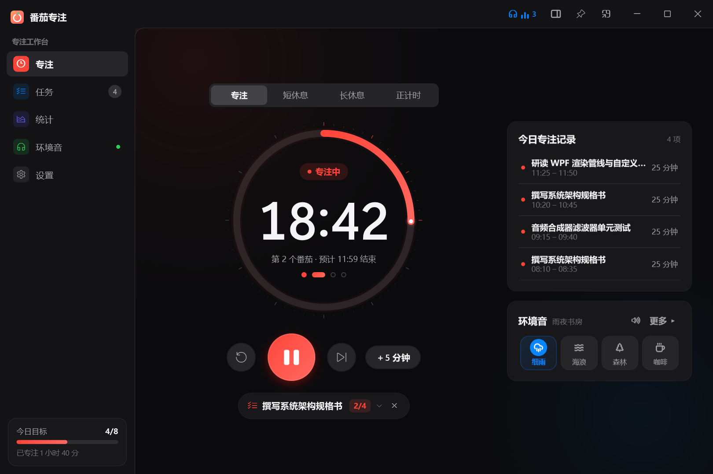
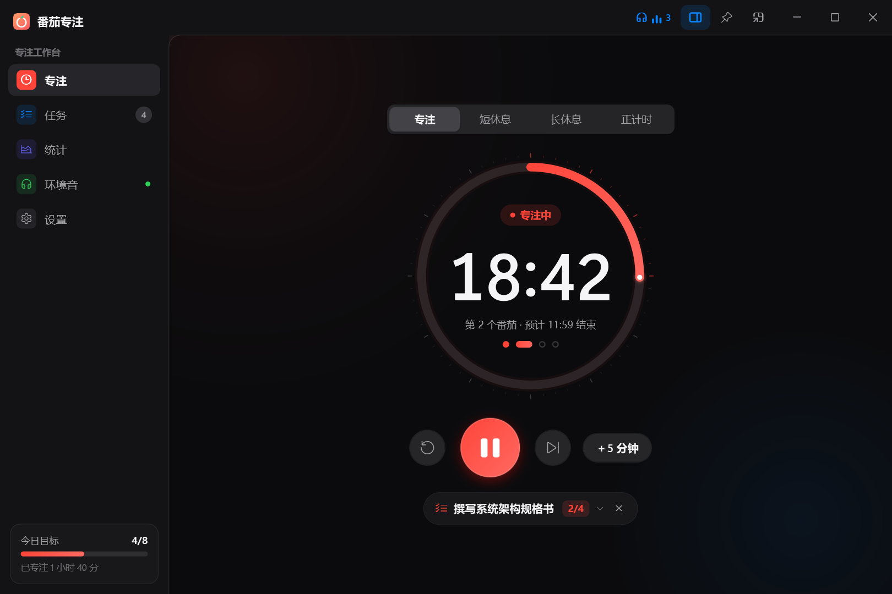
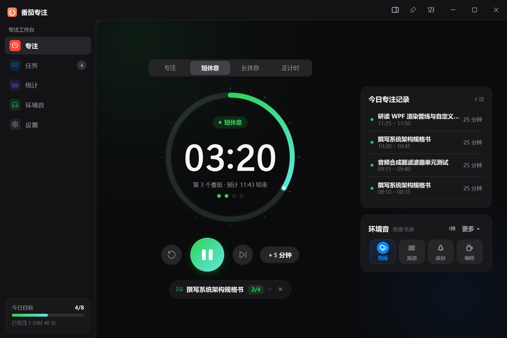
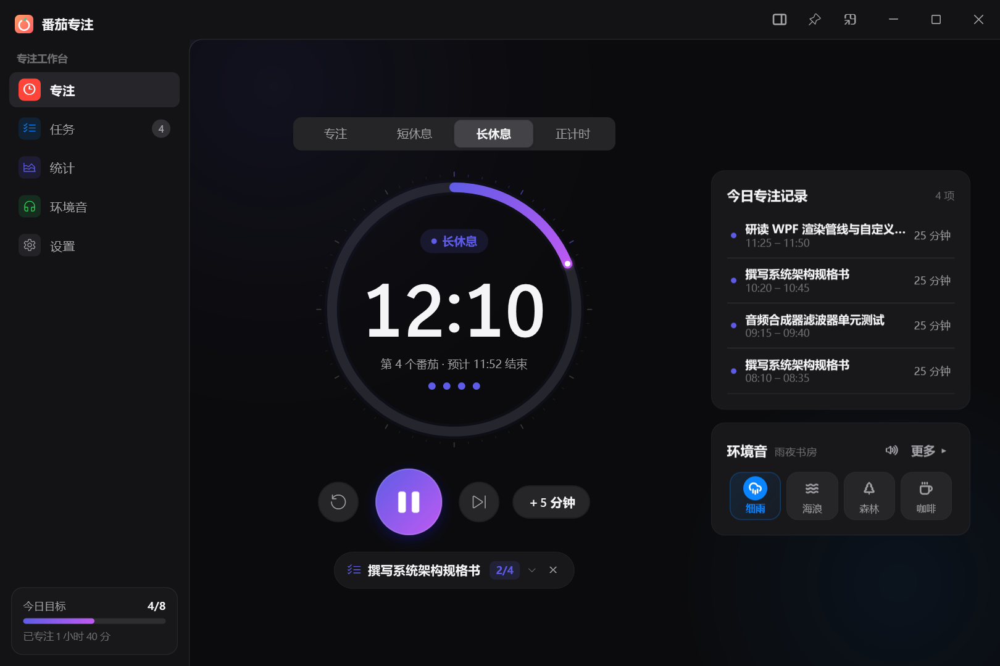
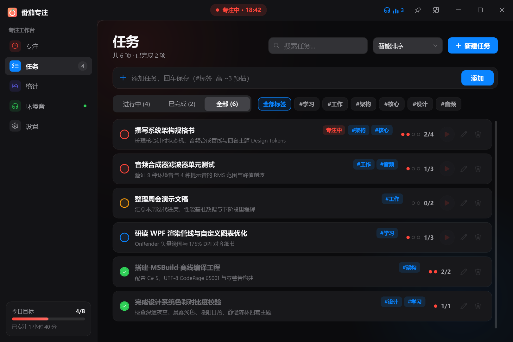
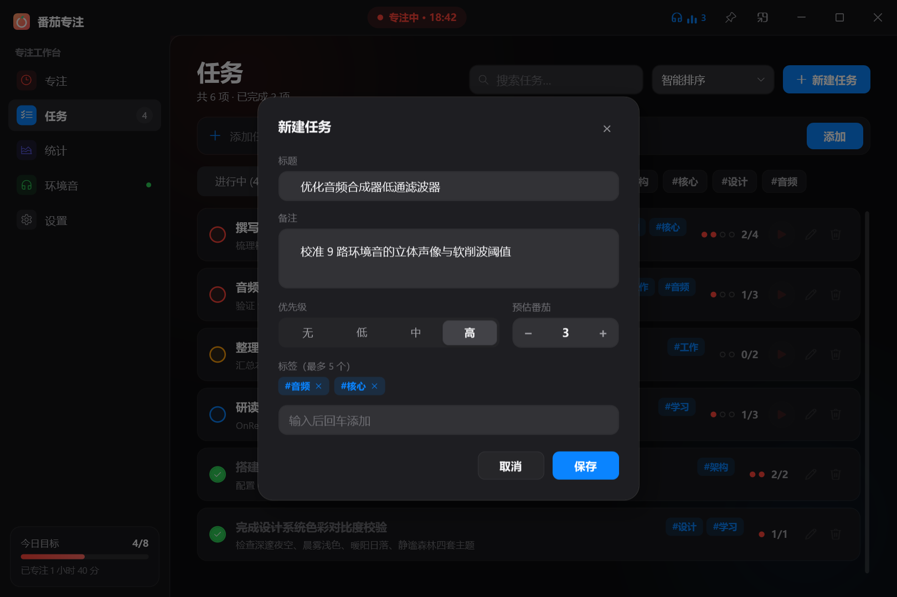
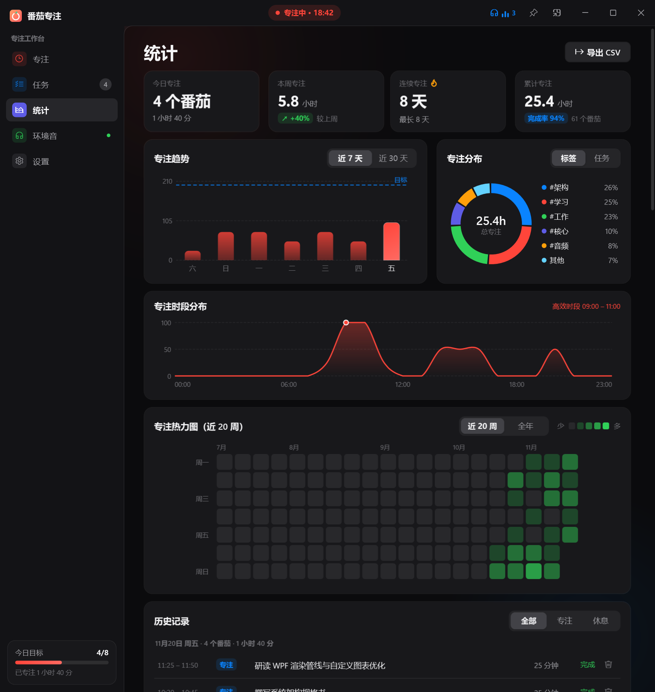
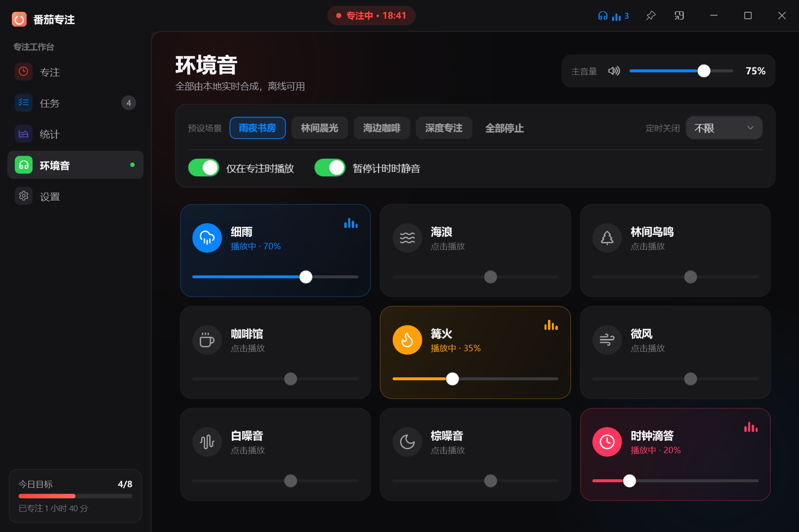
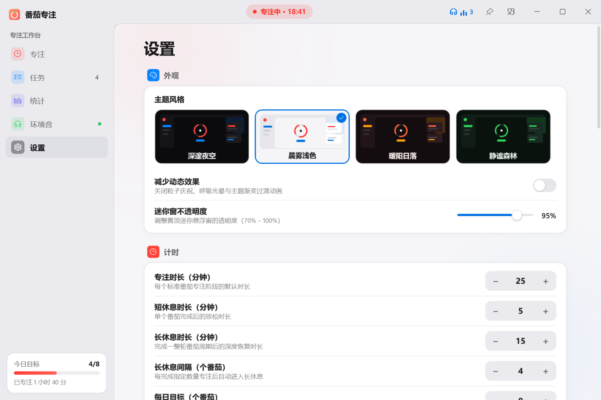
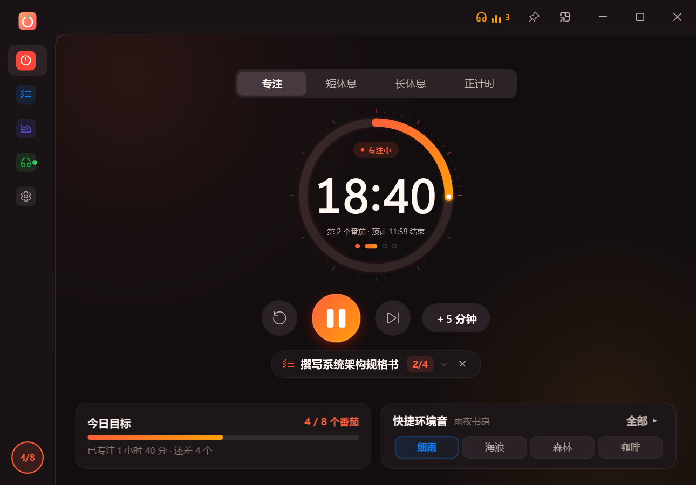

<div align="center">

# 🍅 番茄专注（PomodoroFocus）

**一款面向个人与团队日常使用的现代 Windows 桌面端番茄钟应用**

深色玻璃质感 · 随阶段流动的色彩 · 9 路纯代码 DSP 离线环境音 · 自绘矢量统计图表 · 纯 BCL 零外部依赖

[](https://github.com/cufe5/PomodoroFocus/releases/latest)
[](https://github.com/cufe5/PomodoroFocus/releases/latest)
[](https://dotnet.microsoft.com/)
[](#-从源码构建与测试)
[](#-核心特性)
[](LICENSE)

<p>
  <a href="https://github.com/cufe5/PomodoroFocus/releases/latest"><strong>📥 下载最新绿色版 (GitHub Releases)</strong></a>
  &nbsp;·&nbsp;
  <a href="#-核心特性">核心特性</a>
  &nbsp;·&nbsp;
  <a href="#-界面预览">界面预览</a>
  &nbsp;·&nbsp;
  <a href="#-从源码构建与测试">源码构建</a>
</p>

<br />



</div>

---

## ✨ 核心特性

- **⏱️ 无漂移精准计时引擎**：支持标准番茄（专注 / 短休息 / 长休息）、正计时（Stopwatch）、Idle 点击大数字自定义时长（1–180 分钟）、`+5 分钟` 延长、4 番茄自动长休周期、跨午夜新一天起点（`DayStartHour`）与异常退出/重启恢复；支持一键切换 **禅模式（`Ctrl+\`）** 隐藏右侧栏沉浸专注。
- **🎨 Apple HIG 现代设计语言 + Win11 原生 Mica**：采用全高一体 macOS Source List 侧边栏、圆角内嵌画布与 Windows 11 原生 Mica 云母材质；内置 4 套精调主题（**深邃夜空 `midnight`**、**晨雾浅色 `mist`**、**暖阳日落 `sunset`**、**静谧森林 `forest`**）300ms 无闪烁换肤；系统交互色（Apple Blue / Green）与计时阶段色解耦，配合 600ms 阶段流光、60 刻度纤细渐变圆环、光学居中大数字与 18 粒子完成动效。
- **✅ 高效任务管理闭环**：内置 `#标签 !高 ~3` 快速添加语法、Apple Reminders 风格按优先级着色圆框、右侧操作按钮悬停渐进显露（Progressive Disclosure）、状态与多标签过滤、防抖搜索、4 种排序、模态新建/编辑、删除 6 秒 Snackbar 撤销与专注任务绑定。
- **📊 专注统计与交互式矢量图表**：4 张 KPI 总览卡（含同比趋势与完成率彩色徽章）、7/30 天柔和渐变柱状趋势图（悬停玻璃 Tooltip）、24 小时平滑面积分布图（悬停十字准线与数值胶囊）、Apple 6 色标签/任务环形分布图、近 20 周/全年可切换翡翠绿专注热力图、Inset Grouped 历史明细与 UTF-8 BOM CSV 导出。
- **🎧 9 路纯代码 DSP 实时合成立体声环境音**：iOS 控制中心风格音轨磁贴（未开启滑块自动降噪），无需联网与音频素材，基于 `winmm` waveOut 实时合成 **细雨、海浪、林间鸟鸣、咖啡馆、篝火、微风、白噪音、棕噪音、时钟滴答**；支持多路混音、4 种预设场景、定时关闭 3 秒淡出、专注/暂停联动与 4 种合成提示音（播放时环境音自动闪避 40%）。
- **🖥️ 原生 Windows 桌面体验**：`288×92` 灵动岛胶囊置顶磁吸迷你悬浮窗（内缩悬浮圆角进度条、贴边吸附与透明度调节）、GDI+ 动态进度托盘图标与主题化右键菜单、macOS 风格应用内 Toast 横幅、全局热键录制，以及 500ms 防抖原子 JSON 本地存储（含 `.bak` 损坏自动恢复与全量备份导入导出）。
- **📦 纯 BCL 零外部依赖**：基于系统自带 `.NET Framework 4.8` + `MSBuild.exe` 纯离线编译，无需安装 Visual Studio、无需 .NET SDK、无需拉取任何 NuGet 包。

---

## 🖼️ 界面预览

### 禅模式沉浸专注 · 随阶段流动的色彩

| 禅模式（`Ctrl+\` 折叠右侧栏） | 短休息阶段（薄荷青） | 长休息阶段（星云紫） |
| :---: | :---: | :---: |
|  |  |  |

### 核心功能视图（Reminders 任务 · macOS Sheet · Health 统计 · 控制中心环境音）

| 任务管理与悬停渐进显露 | 新建 / 编辑任务对话框 |
| :---: | :---: |
|  |  |

| 专注统计与交互式矢量图表 | 9 路纯代码 DSP 环境音混音器 |
| :---: | :---: |
|  |  |

### 4 套主题 · 860×600 紧凑响应式 · 灵动岛迷你悬浮窗

| 苹果浅色主题（`mist`）设置中心 | 暖金暗夜（`sunset`）860×600 紧凑布局 | 翠林暗夜（`forest`）288×92 迷你悬浮窗 |
| :---: | :---: | :---: |
|  |  |  |

---

## 📥 下载与使用（绿色免安装，推荐）

普通用户无需安装开发工具或手动编译，直接从 [GitHub Releases](https://github.com/cufe5/PomodoroFocus/releases/latest) 下载预编译绿色包即可开箱即用：

1. 前往 **[最新 Release 页面](https://github.com/cufe5/PomodoroFocus/releases/latest)**（或查看[全部历史版本](https://github.com/cufe5/PomodoroFocus/releases)），在页面底部的 **Assets** 中下载 **`PomodoroFocus-v*-win-x64.zip`**（约 200 KB）。
2. 将压缩包解压到任意文件夹，确保以下文件位于同一目录：
   - `PomodoroFocus.exe`（主程序）
   - `PomodoroFocus.Core.dll`（核心引擎与音频合成库）
   - `PomodoroFocus.exe.config`（`.NET Framework 4.8` 运行时配置）
3. 双击 **`PomodoroFocus.exe`** 即可运行。

> **运行说明**：
> - 支持 **Windows 10（1903 及以上）/ Windows 11 (x64)**，系统内置 `.NET Framework 4.8`，无需安装任何额外运行库。
> - 应用 100% 纯本地离线运行，配置与专注历史自动保存于 `%LocalAppData%\PomodoroFocus\`。
> - 如需先用内置演示数据体验完整统计图表与任务流（不污染个人数据），可在解压目录打开 PowerShell 运行：
>   ```powershell
>   .\PomodoroFocus.exe --seed-demo --data-dir "$env:TEMP\PomodoroFocusDemo"
>   ```

---

## 🚀 从源码构建与测试

### 环境要求

- **操作系统**：Windows 10 / Windows 11 (x64)
- **编译环境**：系统自带 `.NET Framework 4.8` 与 `C:\Windows\Microsoft.NET\Framework64\v4.0.30319\MSBuild.exe`（零第三方依赖，纯离线即可编译运行）

### 一键构建、测试与运行

```powershell
# 克隆仓库后进入项目目录
Set-Location PomodoroFocus

# 一键构建脚本
.\build.ps1                 # 编译 Release|x64（0 错误 0 警告）
.\build.ps1 -Test           # 编译 + 18 项核心单元测试
.\build.ps1 -UiTest         # 编译 + 单元测试 + UIA 端到端交互与 10 张截图校验
.\build.ps1 -Run            # 编译并直接启动应用
.\build.ps1 -Clean          # 清理全部 bin/ obj/
```

### 手动 MSBuild 命令

```powershell
# 1) 编译整个解决方案
& "$env:WINDIR\Microsoft.NET\Framework64\v4.0.30319\MSBuild.exe" PomodoroFocus.sln /t:Build /p:Configuration=Release /p:Platform=x64 /m /nologo /v:minimal

# 2) 运行核心单元测试（18/18）
.\tests\PomodoroFocus.Tests\bin\Release\PomodoroFocus.Tests.exe

# 3) 运行 UI 自动化端到端测试与 10 张截图校验
.\tests\PomodoroFocus.UITests\bin\Release\PomodoroFocus.UITests.exe --out "$env:TEMP\PomodoroFocus.UITests"

# 4) 正常启动应用
.\src\PomodoroFocus.App\bin\Release\PomodoroFocus.exe

# 5) 带演示数据体验（写入临时目录，不污染个人真实数据）
.\src\PomodoroFocus.App\bin\Release\PomodoroFocus.exe --seed-demo --data-dir "$env:TEMP\PomodoroFocusDemo"
```

如需重新生成多尺寸应用图标（16 / 24 / 32 / 48 / 64 / 256 PNG ICO）：

```powershell
powershell -STA -NoProfile -ExecutionPolicy Bypass -File .\tools\New-AppIcon.ps1
```

---

## ⌨️ 快速上手：任务语法与命令行参数

### 任务快速添加语法

在任务页顶部输入框直接回车即可解析属性，例如：

```text
完成季度复盘报告 #工作 #复盘 !高 ~3
```

- `#标签名`：自动提取标签芯片（单条任务最多 5 个标签）
- `!高` / `!中` / `!低`（或 `!3` / `!2` / `!1`）：设置任务优先级
- `~3`（或 `*3`）：设置预估番茄数（自动夹紧在 `0..20`）

### 常用命令行参数

| 参数 | 说明 |
|---|---|
| `--data-dir <path>` | 覆盖本地数据目录（单实例互斥锁按路径哈希隔离） |
| `--seed-demo` | 向数据目录灌入演示任务、65 条历史会话与默认环境音配置 |
| `--theme <midnight\|mist\|sunset\|forest>` | 启动时强制应用指定主题 |
| `--view <focus\|tasks\|stats\|audio\|settings>` | 启动后直接打开指定视图 |
| `--timer-state <idle\|running\|paused\|shortbreak\|longbreak\|stopwatch>` | 启动后将计时器置于指定演示状态 |
| `--mini` | 启动后直接打开 `288×92` 迷你悬浮窗 |
| `--dialog <none\|new-task>` | 启动后打开指定模态对话框 |
| `--no-tray` / `--no-hotkeys` / `--no-sound` | 禁用系统托盘 / 全局快捷键 / 物理音频设备输出 |
| `--minimized` | 静默启动到系统托盘 |
| `--screenshot <output.png>` | 渲染并导出当前窗口高清截图后退出 |
| `--screenshot-suite <output-dir>` | 一键渲染导出 10 张全状态标准视觉截图后退出 |

---

## 🏗️ 项目架构

```text
PomodoroFocus/
├── PomodoroFocus.sln              # 解决方案（Release|x64, Debug|x64）
├── build.ps1                      # 一键构建、测试与运行脚本
├── DESIGN_SPEC.md                 # 完整架构与 UI/UX 设计规格书
├── docs/screenshots/              # 10 张全状态实机视觉截图
├── tools/New-AppIcon.ps1          # 多尺寸矢量渲染 AppIcon.ico 生成脚本
├── src/
│   ├── PomodoroFocus.Core/        # 纯 BCL 核心领域库（零 UI 引用）
│   │   ├── Models/                # 枚举、设置、任务、会话、快照与备份模型
│   │   ├── Engine/                # 无漂移计时状态机与任务快速语法解析器
│   │   ├── Services/              # 任务/统计/原子 JSON 存储/热键与格式化服务
│   │   └── Audio/                 # 9 路立体声 DSP 环境音、4 种提示音与混音器
│   └── PomodoroFocus.App/         # WPF (.NET 4.8) 桌面客户端
│       ├── Assets/                # 多尺寸 AppIcon.ico
│       ├── Interop/               # DWM、全局热键、waveOut 音频、托盘与自启
│       ├── Themes/                # 4 套主题 Token、Fluent/Lucide 图标与换肤服务
│       ├── Controls/              # 60 刻度进度圆环、步进器、分段器与 4 类矢量图表
│       ├── ViewModels/            # MVVM 视图模型层
│       └── Views/                 # 主窗口、5 大核心视图、迷你悬浮窗与 Toast
└── tests/
    ├── PomodoroFocus.Tests/       # 18 项核心单元测试（计时/任务/统计/存储/音频）
    └── PomodoroFocus.UITests/     # Fluent Icons 码位校验 + UIA 端到端测试 + 截图套件
```

---

## 📄 开源许可与致谢

- 本项目基于 [MIT License](LICENSE) 开源。
- 环境音线性矢量图标路径参考 **Lucide Icons**（[ISC License](https://lucide.dev/license)）。
